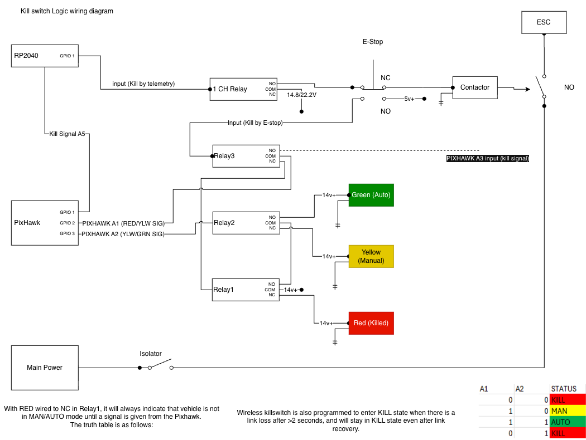

# RP2040 SiK Remote Kill Switch

Prototype two-node remote START/KILL link built around RP2040-Zero boards and a
pair of SiK telemetry radios. The operator unit has two normally-open buttons
and a 1.9-inch ST7789 display. The vehicle unit exposes 3.3 V state outputs for
a Pixhawk 6X AUX input and an isolated relay/driver stage.

There is no limitation to the type of enclosure and buttons used, as long as they are wired in same fashion with logic. In our case we used Eaton A22-IGE1M for the on-board e-stop, and Eaton A22-I2M enclosure with 2 buttons.

This was developed for OptiPrime's entry to RobotX 2026 — USV Kill Switch POR. Concept and hardware developed by Nigel, software and assembly developed by Hugh. AI was used to assist in programming the logic.

> [!CAUTION]
> This is experimental firmware, not a certified safety controller. Do not use
> it as the only means of removing hazardous energy. Keep a hard-wired,
> normally-closed emergency-stop circuit in series with the contactor coil and
> commission the system without propellers, traction power, or other hazardous
> loads connected.



## Operation

- **RED** latches and transmits `KILL`.
- **GREEN** requests `RESET`/START.
- The transmitter sends a state heartbeat every 250 ms.
- The receiver enters `KILL` after 2 seconds without a valid operator packet.
- Recovery of the radio link does not clear `KILL`; a new explicit RESET button
  press is required.
- Both RP2040 watchdogs are serviced in their main loops.
- SiK `RADIO_STATUS` messages provide local and remote RSSI to the LCD.

The display separates the requested command from the receiver's acknowledged
state:

```text
CMD: RESET
RX: KILL
LINK: OK
RSSI L: 210
RSSI R: 205
```

## Important diagram notes

1. The `5V+` label beside the E-stop belongs to its auxiliary **NO sensing
   contact**. Pressing the E-stop closes this path, activates the low-level
   sensing relay, and produces an isolated 3.3 V logic signal for the Pixhawk.
   It is not the EV200AAANA coil supply.
2. The EV200 coil is powered through the E-stop's separate **NC safety contact**
   from the vehicle's protected 14.8/22.2 V control supply. Opening that NC
   contact physically removes contactor-coil power.
3. The diagram's generic RP2040 `GPIO1` relay output must not be interpreted as
   physical **GP1**. GP1 is the SiK UART receive pin. This firmware uses **GP13**
   as the additional relay-state output and **GP10** for Pixhawk AUX5.
4. Neither RP2040 output may drive the EV200 coil directly. Use an appropriately
   rated isolated relay or driver stage.

See [Wiring and hardware](docs/WIRING.md) before connecting hardware.

## Repository layout

```text
firmware/transmitter/   Operator RP2040 Arduino sketch
firmware/receiver/      Vehicle RP2040 Arduino sketch
release/                Precompiled UF2 firmware
docs/                   Wiring, protocol, radio and test documentation
scripts/                Reproducible Windows build script
tools/                  Optional Windows serial monitors
```

## Quick start

1. Read [Wiring and hardware](docs/WIRING.md), especially the diagram
   corrections and contactor warnings.
2. Configure both radios using [SiK radio configuration](docs/RADIO_CONFIG.md).
3. Hold BOOTSEL while connecting each RP2040-Zero and copy the corresponding
   UF2 from [`release`](release/).
4. Complete the staged tests in [Commissioning and testing](docs/TESTING.md).

To compile from source, run `scripts/build.ps1` from PowerShell. The build uses
the Earle Philhower Arduino-Pico core and the Adafruit ST7789/GFX libraries.

## Hardware references

- [TE Connectivity EV200AAANA product page](https://www.te.com/en/product-1618002-7.html)
- [ArduPilot SiK advanced configuration](https://ardupilot.org/copter/docs/common-3dr-radio-advanced-configuration-and-technical-information.html)
- [MAVLink RADIO_STATUS message](https://mavlink.io/en/messages/common.html#RADIO_STATUS)
- [LCDwiki 1.9-inch IPS module](https://www.lcdwiki.com/1.9inch_IPS_Module)

## License

Firmware and repository documentation are provided under the [MIT License](LICENSE).
